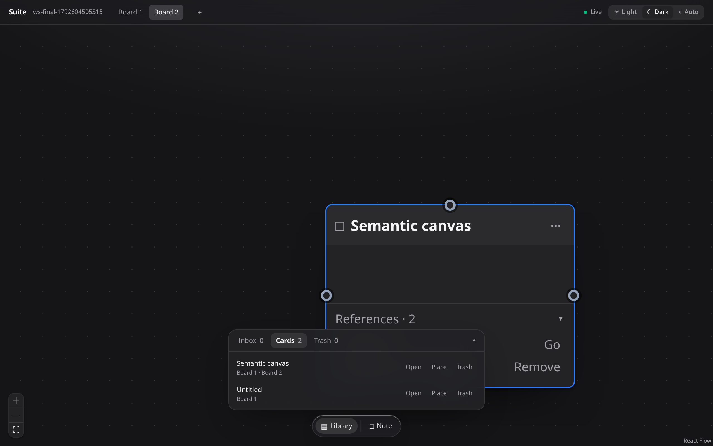
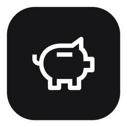
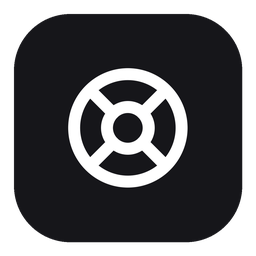

# Suite

A local-first suite of apps, a hub that installs and updates them, and sync you run yourself. Every
document is a file you own. There is no account, no telemetry, and no server operated by the project.



> **Alpha.** Canvas is the most developed app; Planner and Budget are pre-alpha. Linux is the only
> platform with published builds. Keep documents somewhere you back up.

## The apps

Install **Suite Start** first: it installs, updates and opens the other desktop apps. On a phone,
install **Suite Go**.

### Desktop

| App | What it is | State | Install |
| --- | --- | --- | --- |
| **Suite Start** | The hub: installs, updates, opens and removes the other apps | Working | `flatpak install --user suite run.suite.start` |
|  **Suite Canvas** | Thinking and research: cards, boards, writing, links and views in one document | Alpha | `flatpak install --user suite run.suite.canvas` |
|  **Suite Planner** | A daily planner: inbox, estimates, capacity and a local calendar | Pre-alpha | `flatpak install --user suite run.suite.planner` |
|  **Suite Budget** | An envelope budget: give every dollar a job; [what it does](apps/budget/README.md) | Pre-alpha | `flatpak install --user suite run.suite.budget` |
| **Suite Sync** | The sync protocol and a relay a person runs | Working | `flatpak install --user suite run.suite.sync` |
|  **Suite Help** | The documentation app: the code explorer and the handbook, offline; [what it is](apps/help/README.md) | Working | `flatpak install --user suite run.suite.help` |

Windows and macOS have no published build.

### Mobile

| App | What it is | State | Install |
| --- | --- | --- | --- |
| **Suite Go** | One mobile container that hosts the domains as packs | Shell only | [Android APK](https://github.com/mrrnbhd/suite-apps/releases/latest/download/suite-go.apk) |

iOS has no published build.

Canvas, Planner and Budget own their documents. Start launches them as separate processes and is not
in the data path. Sync carries a document between devices; it never defines its schema.

## Install

Add the signed store once, then run the command in the row you want. Every desktop app is a Flatpak
on that store, including Sync — the relay you run yourself, on a desktop or on a machine with no
display.

```sh
flatpak remote-add --user --if-not-exists --from suite \
  https://flatpak.suite.run/suite.flatpakrepo
```

[Installing Suite Start](apps/start/docs/how-to/install.md) owns the first launch and what each card
means. Open Start, install Canvas, and start with
[Make a first workspace](docs/tutorials/02-first-workspace.md).

## Releases

One rolling `suite-YYYY.MM.DD` release is the repository's GitHub Latest; per-app releases are
history, and the signed Flatpak remote is the update path. [RELEASES.md](RELEASES.md) mirrors the
same table with each app's version, release date and per-app tag.

## How it fits together

- **Documents are files.** `.canvas`, `.planner` and `.budget` live in `~/Documents/Suite/<App>`. They
  can be copied, backed up and opened offline.
- **The hub is not a host.** Start returns a path or a URL and launches a separate signed process. It
  never proxies document bytes.
- **Sync is yours.** A person runs the relay on a NAS, a Raspberry Pi or a laptop. It stores sealed
  frames it cannot read, plus the signed roles, invitations, pinned keys and removals it needs to
  admit them. It is loopback by default; a relay other devices reach serves `wss://` with a
  self-signed certificate the app pins by SHA-256.
- **The mobile container follows the mini-app model.** A manifest, declared capabilities, one
  instance per app, and a document the container never parses. The desktop hub shares the manifest
  and the one-instance rule.

[Architecture](docs/explanation/architecture.md) has the boundaries,
[the mini-app model](docs/explanation/mini-app-model.md) explains what is borrowed from WeChat and the
W3C MiniApp specification, and [Local-first](docs/explanation/local-first.md) records which ideals are
met and which are still partial.

## Status

| | |
| --- | --- |
| Platforms | Linux x86_64. Flatpak for Canvas, Planner, Budget, Help, Start and Sync (the relay); no macOS or Windows build. |
| Sync | Canvas and Planner sync through a user-run relay; Start shows the relay's fingerprint and opens its console. Budget has no network client. |
| Security | No account or telemetry. Document files are unencrypted; use disk encryption. The sync relay holds sealed frames; off loopback it uses `wss://` with a pinned self-signed certificate, and it is loopback by default. |
| Mobile | Suite Go installs on Android as a debug build. No domain ships; iOS is unbuilt. |
| Gate | Local, at the repository root. No CI service gates a pull request. |

[Status](docs/reference/status.md) has the subsystem-by-subsystem detail.

## Build from source

Node and pnpm are pinned in `package.json`; `mise exec --` resolves both.

```sh
mise exec -- pnpm install
mise exec -- node scripts/gate.mjs                 # every app, in dependency order
mise exec -- node scripts/gate.mjs --only canvas
mise exec -- node scripts/gate.mjs --fresh         # prove the commit, not the tree
```

Read [Commands](docs/reference/commands.md) before running a heavy check; the first unbounded run
took the desktop down. The layout and package ownership are in
[Repository layout](docs/reference/repo-layout.md).

## Documentation

The primary reader is Suite Help, the shipped documentation app. Run `pnpm docs:dev` at the
repository root to open it: the explorer indexes every file and declaration and offers three views —
**Browser** (the file tree), **Modules** (one narrative per module) and **Tours** (ordered paths
through the code). Reference facts are derived; module notes and tours carry the prose. `docs:dev`
opens an Electron window, so headless checks use `docs:index`, `docs:index:check`, `docs:coverage`
or `docs:build` instead.

This is an offline app, not a hosted site. The older notes stay in [docs](docs/README.md):
decisions, architecture, commands and the app-specific docs. They are a notes archive, not a
separate reading path.

## Contributing

Read `AGENTS.md` at the root and the owning app's `AGENTS.md` before editing. One app per change;
shared packages are `workspace:*`. [Contribute a change](docs/how-to/contribute.md) has the branch,
commit, docs and verification rules.

Report a vulnerability per the owning app's `SECURITY.md`.

## Licence

MIT, © Suite contributors.
