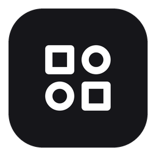
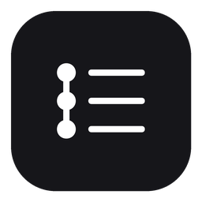

# Suite

A local-first suite of apps, a hub that installs and updates them, and sync you run yourself. Every
document is a file you own. There is no account, no telemetry, and no server operated by the project.


> **Alpha.** Canvas is the most developed app; Planner and Budget are pre-alpha. Linux is the only
> platform with published builds. Keep documents somewhere you back up.

## The apps

| App | What it is | State |
| --- | --- | --- |
|  **Suite Canvas** | Thinking and research: cards, boards, writing, links and views in one document | Alpha |
|  **Suite Planner** | A daily planner: inbox, estimates, capacity and a local calendar | Pre-alpha |
|  **Suite Budget** | An envelope budget: accounts, register, month grid and rolling backups | Pre-alpha |
| **Suite Start** | The hub: installs, updates, opens and removes the other apps | Working |
| **Suite Sync** | The sync protocol and a server a person runs | Phase 2 demo |
| **Suite Go** | One mobile container that hosts the domains as packs | Shell only |

Canvas, Planner and Budget own their documents. Start launches them as separate processes and is not
in the data path. Sync carries a document between devices; it never defines its schema.

## Install

Suite Start is the only piece you fetch by hand. Every other app arrives through it.

**On Arch**, download the current package from the
[latest release](https://github.com/mr-rogers-neighborhood/suite-start/releases/latest):

```sh
sudo pacman -U suite-start-bin-<version>-1-x86_64.pkg.tar.zst
```

**Everywhere else**, download `suite-start-<version>-x86_64.AppImage` from the same release:

```sh
chmod +x suite-start-<version>-x86_64.AppImage
./suite-start-<version>-x86_64.AppImage
```

An AppImage needs FUSE 2; `--appimage-extract-and-run` works without it. Open Start, install Canvas,
and start with [Make a first workspace](docs/tutorials/02-first-workspace.md). The full checksum and
troubleshooting steps are in [Install Suite Start](docs/tutorials/01-install.md).

## How it fits together

- **Documents are files.** `.canvas`, `.planner` and `.budget` live in `~/Documents/Suite/<App>`. They
  can be copied, backed up and opened offline.
- **The hub is not a host.** Start returns a path or a URL and launches a separate signed process. It
  never proxies document bytes.
- **Sync is yours.** A person runs the server on a NAS, a Raspberry Pi or a laptop. The target is a
  relay that stores ciphertext it cannot read; today the room is plaintext and loopback-only.
- **The mobile container follows the mini-app model.** A manifest, declared capabilities, one
  instance per app, and a document the container never parses. The desktop hub shares the manifest
  and the one-instance rule.

[Architecture](docs/explanation/architecture.md) has the boundaries,
[the mini-app model](docs/explanation/mini-app-model.md) explains what is borrowed from WeChat and the
W3C MiniApp specification, and [Local-first](docs/explanation/local-first.md) records which ideals are
met and which are still partial.

## Status

| | |
| --- | --- |
| Platforms | Linux x86_64. AppImage and Arch package for the hub; Flatpak experimental; no macOS or Windows build. |
| Sync | Canvas syncs through a user-run server. Planner and Budget do not sync yet. |
| Security | No account or telemetry. Documents are unencrypted; use disk encryption. The sync room is plaintext. |
| Mobile | Suite Go installs on Android as a debug build. No domain ships; iOS is unbuilt. |
| Gate | Local, at the repository root. No CI service gates a pull request. |

[Status](docs/reference/status.md) has the subsystem-by-subsystem detail.

## Build from source

Node and pnpm are pinned in `package.json`; `mise exec --` resolves both.

```sh
mise exec -- pnpm install
mise exec -- node scripts/gate.mjs                 # every app, in dependency order
mise exec -- node scripts/gate.mjs --only canvas
mise exec -- node scripts/gate.mjs --fresh         # prove the commit, not the tree
```

Read [Commands](docs/reference/commands.md) before running a heavy check; the first unbounded run
took the desktop down. The layout and package ownership are in
[Repository layout](docs/reference/repo-layout.md).

## Documentation

| | |
| --- | --- |
| [Tutorials](docs/tutorials/index.md)<br>Install, first workspace, two devices. | [How-to](docs/how-to/index.md)<br>Update apps, back up, run the gate, package, contribute. |
| [Reference](docs/reference/index.md)<br>Layout, commands, channels, formats, environment, status. | [Explanation](docs/explanation/index.md)<br>What Suite is, local-first, the mini-app model, architecture. |

App-specific docs stay beside each app: `apps/<app>/docs/`. The current rules are in
[Decisions](docs/reference/decisions.md).

## Contributing

Read `AGENTS.md` at the root and the owning app's `AGENTS.md` before editing. One app per change;
shared packages are `workspace:*`. [Contribute a change](docs/how-to/contribute.md) has the branch,
commit, docs and verification rules.

Report a vulnerability per the owning app's `SECURITY.md`.

## Licence

MIT, © Suite contributors.
