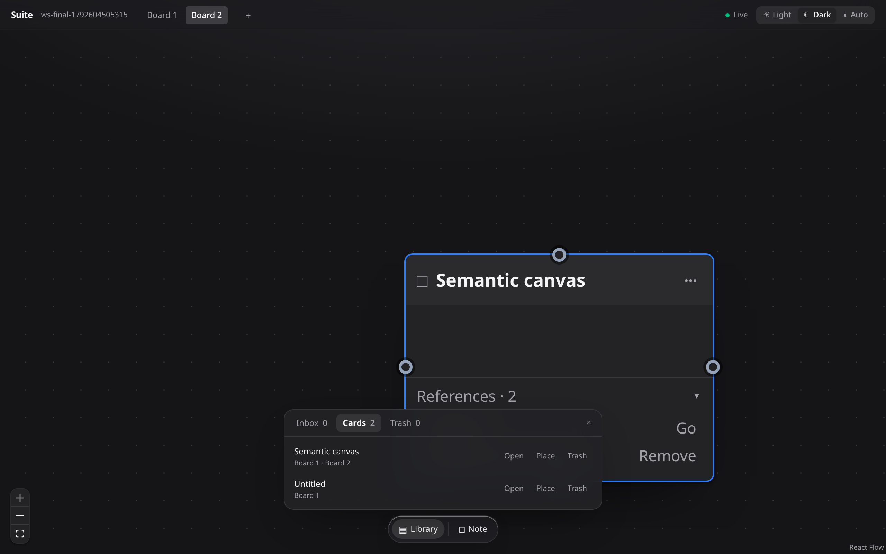

# Suite Canvas

**A canvas for thinking in connections.** Cards, boards and writing live in one document, on your
machine, in a file you own.



> **Alpha.** Canvas is the most developed app in the suite and still changes shape. Keep the file
> somewhere you back up, and expect to export rather than rely on it.

---

For the product story and the influences behind it, read
[What Suite is](../../docs/explanation/why-suite-exists.md).

## What it does

- **Cards are objects, not text on a page.** Notes, images, links, tasks and files can appear on any
  number of boards, with their own type, tags and connections, and one edit updates every place they
  appear.
- **Boards are views.** Arrange the same cards differently for different questions instead of copying
  them.
- **Rich text where you want it.** Every card opens into a full editor, with mentions, checklists,
  tables and images.
- **Works offline, always.** The document is a CRDT in this app and a file on disk. There is no
  account to sign in to and nothing to reach.
- **Sketch and link.** A Sketch card is an Excalidraw drawing embedded on a board; a Portal card
  opens another board.
- **Nothing is trapped.** Export the workspace as one `.canvas` file and keep it beside whatever you
  already back up.

## Run it

Node and pnpm are pinned in the root `package.json`.

```sh
pnpm install
pnpm dev            # the renderer, at http://localhost:5173
```

The browser build runs the whole app against local storage, which is the fastest way to work on it.
The thing that ships is the desktop app:

```sh
pnpm dev:desktop    # Electron shell around the same renderer
pnpm --filter @suite/canvas-desktop package:dir   # an unpacked binary in desktop/release
```

On Linux, Canvas ships as the Flatpak `run.suite.canvas`. A pre-release build is a separate Flatpak
branch, `slop`, `canary` or `beta`, and keeps its documents in `~/Documents/Suite Slop/Canvas`,
separate from the stable library.

## How it is built

React 19 on a React Flow surface, one Loro CRDT document per workspace, a typed object graph validated
by Zod, and an Electron shell that owns the file. Zustand holds UI state only: document truth lives in
the CRDT and nowhere else.

| Path | What lives there |
| --- | --- |
| `packs/canvas/src` | The renderer: launcher, boards, cards, editor, panels |
| `src/main.tsx` | The shell's entry, which loads the pack-owned renderer |
| `desktop` | The Electron shell: the file, the lock, the window, packaging |
| `packs/canvas/packages/graph` | `@suite/graph`: the schema and the document layer |
| `packs/canvas/packages/import-obsidian` | Reads an Obsidian vault into a document |
| `e2e` | The Playwright suites, including the desktop one |
| `docs/reference/decisions.md` | The rules that shape Canvas |

It stands on other people's work, and each is worth a look on its own: [Loro](https://loro.dev) for the
document, [React Flow](https://reactflow.dev) for the surface, [Tiptap](https://tiptap.dev) for the
editor, [Zod](https://zod.dev) for the schema, [Excalidraw](https://excalidraw.com) for the sketch.

[Architecture](docs/reference/architecture.md) is the longer version, and
[the conventions](docs/explanation/suite-conventions.md) say what Canvas shares with the other apps —
and what it deliberately does not.

## Documentation

Where accessibility stands, and what is checked by hand: [ACCESSIBILITY.md](ACCESSIBILITY.md).

| | |
| --- | --- |
| [Tutorials](docs/tutorials/index.md)<br>Learn by doing. | [How-to](docs/how-to/index.md)<br>One job at a time: add a feature, change the model, test. |
| [Reference](docs/reference/index.md)<br>Facts to look up: architecture, the data model, the desktop plumbing. | [Explanation](docs/explanation/index.md)<br>Why the product and the code are shaped this way. |

## Working in the monorepo

The apps, the hub and the sync server share one repository and one gate. Start with the
[root README](../../README.md), then [Commands](../../docs/reference/commands.md) for the gate and
[Repository layout](../../docs/reference/repo-layout.md) for where each package lives.

## Contributing

Issues and pull requests are welcome. [CONTRIBUTING.md](CONTRIBUTING.md) is the short version and
[docs/how-to/contribute.md](docs/how-to/contribute.md) the full one; `pnpm check` is the gate a change
runs against, and [AGENTS.md](AGENTS.md) holds the rules for human and AI contributors.

Report a vulnerability per [SECURITY.md](SECURITY.md). Participation is covered by
[CODE_OF_CONDUCT.md](CODE_OF_CONDUCT.md).

## Licence

MIT, © Suite contributors.
