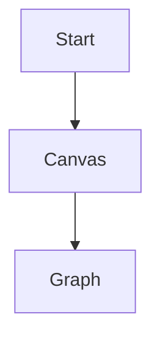

## Code imported from a file

The block below is read from `sample.ts` at build time, not copied into this page.

```ts
!from ./sample.ts 1:13
```

## Mermaid

Code Hike is told to ignore Mermaid, so Fumadocs renders it as an ordinary fenced block.



## Layouts

- [Scrollycoding](/spike)
- [Spotlight](/spotlight)
